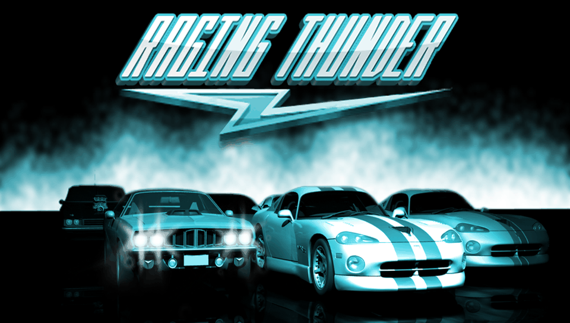

<h1 align="center">
  <br>
  Raging Thunder · PS Vita Port
</h1>

<p align="center">
  <b>Native port of Raging Thunder (Polarbit) for PlayStation Vita and PlayStation TV.</b>
</p>

<p align="center">
  
  
  
  
  
  
</p>

<p align="center">
  <a href="#-description">Description</a> •
  <a href="#-features">Features</a> •
  <a href="#-controls">Controls</a> •
  <a href="#-installation">Installation</a> •
  <a href="#-known-issues">Known Issues</a> •
  <a href="#-building-from-source">Build</a> •
  <a href="#-credits">Credits</a>
</p>

> **Disclaimer:** this project contains no game assets. You must provide your own legally obtained copy of the game
> (APK v1.2.1). See [Installation](#-installation).

---

## 📖 Description

**Raging Thunder** is an arcade racing game originally released for Android by Polarbit (Polarbit Fuse engine, GLES 1.1).
This port loads the unmodified `librthunderlite.so` (`armeabi`) and re-implements the Android/Java layer it expects:
lifecycle, EGL/GLES 1.1, touch / key / accelerometer input, audio mixing, file access and LiveArea. The game runs natively
on the Vita through TheFloW's so-loader and FalsoJNI, with rendering through vitaGL.

The loader is shared with the [Raging Thunder 2 port](https://github.com/MetalSyntax/Raging-Thunder-2-vita): both games run
the same engine (identical JNI table, verified from the real `.so` files).

---

## 🎮 Status & Playability

**Status: Playable (beta)**. Menus and races run on real hardware without crashes (initial test by the author on 2026-10-10,
recorded in `port_progress.md`). Two items are still open: progress saving has not been tested yet, and the online features
have no connectivity.

- [x] **Menus and races**: run on the console without crashes (v1.0.0 release notes, 2026-10-10 test). *Verified on console.*
- [x] **Race controls**: Cross accelerates, Square brakes, Triangle is nitro. Fixed in v1.0.1 from tester reports (`port_progress.md`). *Verified on console.*
- [x] **Background flicker**: fixed in v1.0.2 (tester report, confirmed on console per `port_progress.md`). *Verified on console.*
- [ ] **Saves**: progress saving is implemented (`saves/`, `CSaveManager`) but **not yet tested**. Please report whether career progress persists after a restart.
- [ ] **Online (news / multiplayer)**: no connectivity; the requests fail gracefully.

### Key Points

- Rendering: vitaGL (vendored, softfp), MSAA up to 4x, 960×544.
- Input: buttons, touch screen, left-stick tilt emulation and real motion controls.
- Audio: engine mixer streamed through `SceAudioOut`.
- Saves and settings stored under `ux0:data/ragingthunder/`.

### Changelog

**v1.0.2** (2026-11-13)
- **Background flicker**: during races and in the garage the engine only clears the depth buffer, so areas the sky did not cover
  showed stale frames from vitaGL's triple buffers. The colour buffer is now cleared every frame (`gl_swap()` in `glutil.c`),
  restoring the engine's clear colour. Install over v1.0.1; the game files and saves are kept.

**v1.0.1** (2026-10-17, fixes from tester reports)
- **Race buttons**: Raging Thunder 1 keeps the engine's generic key masks, so Cross was nitro and Square / Triangle did nothing.
  Cross now accelerates, Square brakes and Triangle is nitro (L / R unchanged).
- **Start always pauses**: the back key is held for 6 frames instead of 1.
- **Lighting / shadows** no longer jump between meshes: an unlit draw consumed vitaGL's matrix-changed flag without
  refreshing the normal matrix.
- **Start + Select menu**: no more input lag (redrawn only when it changes).
- **Docs**: in the game menus Triangle is OK and Cross does nothing.
- If you already have a `controls.txt` from v1.0.0, it keeps your bindings; the new race actions apply to whatever buttons
  are bound to ACCELERATE / BRAKE / NITRO.

**v1.0.0** (2026-10-10, first public release)
- Menus and races playable on real hardware, no crashes. Tested on a console with HENkaku/Enso, kubridge and libshacccg.
- Loader synced from the hardware-tested Raging Thunder 2 port (same Polarbit Fuse engine, JNI table verified identical).
- vitaGL vendored (softfp), GLES 1.1, MSAA up to 4x, 960x544.
- Controls: physical buttons, touch, stick / motion steering, remappable menu.
- Audio through `SceAudioOut`; saves under `ux0:data/ragingthunder/`.
- Hardware-proven fixes from the sibling port: VBO name handling, corrected environment reflections, bionic `stat64` layout,
  clean exit from the game menu.
- Known at release: progress saving not yet tested.

---

## ✨ Features

| Feature | Status | Notes |
| :--- | :---: | :--- |
| Boots to gameplay | ✅ | Menus and races run on hardware (v1.0.0, 2026-10-10 test) |
| Graphics / renderer | ✅ | vitaGL GLES 1.1, MSAA up to 4x, 960×544. Background flicker fixed in v1.0.2 (tester report) |
| Audio & music | 🧪 | Engine mixer through `SceAudioOut`; the test notes do not call out audio separately |
| Video / cutscenes | 🧪 | Not documented in the repository <!-- TODO: confirm --> |
| Physical buttons | ✅ | Race buttons corrected in v1.0.1 from tester reports; Start pauses reliably |
| Analog sticks / camera | 🧪 | Left stick steering (tilt emulation) and motion steering (`steering 1`); not separately recorded |
| Touch screen | ✅ | Menus and HUD (part of the hardware-tested menus and races) |
| Button remapping / port menu | ✅ | Start + Select opens the PS Vita controls menu; bindings in `controls.txt` (remapping confirmed by tester reports) |
| Save data | 🧪 | Implemented; not yet tested. Please report whether progress persists |
| Native trophies | ➖ | No trophy data in the repository |
| Languages | 🧪 | `language` key in `config.txt` (0 = system, 1–6 = fixed); not tested per language |
| Performance | 🧪 | 960×544 with MSAA options; `show_fps` overlay available. No measured numbers in the repository |
| Online / IAP / ads | ❌ | News and multiplayer attempt raw sockets without `sceNetInit`; they fail gracefully with no connectivity |
| PS TV | 🧪 | Not tested (not documented) |

Legend: `✅ Working (verified on console) · 🧪 Implemented, not yet verified on console · 🟡 Partial · ❌ Not working · ➖ Not applicable · ❔ Not documented yet`

---

## 🎯 Controls

Default layout (remappable, see below):

| Vita input | In-game action |
|---|---|
| ✕ Cross / R trigger | Accelerate (does nothing in menus) |
| ■ Square / L trigger | Brake / reverse |
| ▲ Triangle | Nitro (**OK / confirm in menus**) |
| ● Circle / Start | Back / pause |
| D-Pad | Menus; left / right steer |
| L / R in menus | Switch page |
| Left stick | Steering (emulated tilt; D-Pad in menus) |
| Touch screen | Menus and HUD |
| **Start + Select** | **PS Vita controls menu** |

Steering follows the game's tilt mode: when a race uses tilt steering, the left stick emulates the accelerometer (and doubles
as the D-Pad otherwise). Choose *Tilt (motion)* in the controls menu (or set `steering 1` in `config.txt`) to use the Vita's
real motion sensor instead.

### Remapping

Press **Start + Select** at any time (menus or race) to open the **PS Vita controls** menu. The game is paused while it is
open (clock frozen, audio muted), and the menu is drawn over a dimmed copy of the last frame.

| In the menu | |
|---|---|
| D-Pad up / down | Choose a row |
| ✕ on an action | Replace its buttons (press the new button) |
| ■ on an action | Add another button |
| ▲ on an action | Clear it |
| D-Pad left / right | Change steering mode, sensitivity, invert |
| ● / Start | Save and close |

Bindings are saved to `ux0:data/ragingthunder/controls.txt`, which can also be edited by hand (created with the defaults on
first boot):

```ini
ACCELERATE = CROSS
BRAKE = SQUARE
NITRO = TRIANGLE
BACK = CIRCLE
L = L1          # shoulder keys: brake / accelerate in the race,
R = R1          # page switch in the menus
UP = UP
DOWN = DOWN
LEFT = LEFT
RIGHT = RIGHT
```

Buttons: `CROSS, CIRCLE, SQUARE, TRIANGLE, L1, R1, UP, DOWN, LEFT, RIGHT, SELECT, NONE`. Start is always back / pause and is
not bindable. `BUTTON = ACTION` lines are accepted too.

---

## 📋 Prerequisites

| Requirement | Notes |
|---|---|
| HENkaku / Enso | Any recent firmware with homebrew support |
| [kubridge.skprx](https://github.com/TheOfficialFloW/kubridge) | Required, loaded in the taiHEN config (`*KERNEL`) |
| [libshacccg.suprx](https://github.com/Rinnegatamante/ShaRKBR33D) | Required at `ur0:data/libshacccg.suprx` (extract with ShaRKBR33D) |
| Game data files | Copied from your own APK (see below, not distributed) |

---

## 📦 Installation

1. Install `ragingthunder.vpk` from the [latest release](https://github.com/MetalSyntax/Raging-Thunder-vita/releases) with VitaShell.
2. From your own `raging-thunder-free-1-2-1.apk` (open it as a ZIP), copy:

   | APK path | Vita destination |
   |---|---|
   | `lib/armeabi/librthunderlite.so` | `ux0:data/ragingthunder/main.so` |
   | `assets/data.vfs` | `ux0:data/ragingthunder/assets/data.vfs` |

3. Launch the game. The `logs/` and `saves/` folders are created automatically.

> `config.txt` is generated on first boot at `ux0:data/ragingthunder/config.txt`. Logs go to
> `ux0:data/ragingthunder/logs/ragingthunder_NNN.log`.

Updating: install the new VPK over the old one with VitaShell. The game files (`main.so`, `assets/data.vfs`) and saves are kept.

### ⚙️ Options

`ux0:data/ragingthunder/config.txt` (created on first run):

| Key | Default | Description |
|---|---|---|
| `language` | `0` | 0 = system, 1–6 = fixed language |
| `steering` | `0` | 0 = left stick, 1 = Vita accelerometer |
| `steer_sensitivity` | `100` | 25–400 |
| `invert_steering` | `0` | 0 / 1 |
| `show_fps` | `0` | 0 / 1, FPS overlay |
| `msaa` | `2` | 0 = off, 1 = 2x, 2 = 4x |
| `engine_log` | `0` | 0 / 1, verbose engine log (for debugging) |
| `vfp_float` | `1` | 0 / 1, hardware float helpers |
| `xperia_pad` | `1` | 0 / 1, Xperia Play button layout |

---

## 🐛 Known Issues

- **Progress saving** is implemented but **not yet tested**. Please report whether career progress persists after restarting.
- **Online features** (news / multiplayer) attempt raw sockets without `sceNetInit`. They fail gracefully but have no connectivity.
- **Quitting from the main menu** takes a few seconds (the engine releases its resources in `OnDestroy`).
- **Reporting bugs**: open an issue with your log file (`ux0:data/ragingthunder/logs/ragingthunder_NNN.log`) attached. Set
  `engine_log 1` in `config.txt` for a verbose log.

---

## 🔨 Building from Source

Requirements: [VitaSDK](https://vitasdk.org/), CMake, Git.

```sh
git clone https://github.com/MetalSyntax/Raging-Thunder-vita.git
cd Raging-Thunder-vita
mkdir build && cd build
cmake ..
make
```

This produces `eboot.bin` and `ragingthunder.vpk`. vitaGL is vendored under `vendor/vitaGL` and builds automatically with the
required `SOFTFP_ABI=1` flags.

> If your checkout path contains spaces, build through [`psvita-toolkit`](https://github.com/MetalSyntax/psvita-port-toolkit)
> (`psvita-toolkit build`), which stages the tree in a temp dir. `vita-pack-vpk` breaks on paths with spaces.

---

## 📁 Project Structure

- `source/`: loader, JNI bridge, input, audio and the glue for the Polarbit engine.
- `lib/`: support libraries (`libc_bridge` and the others used by the loader).
- `vendor/vitaGL/`: vitaGL built with the softfp ABI.
- `extras/livearea/`: LiveArea assets (`icon0.png`, `pic0.png`, `bg0.png`, `startup.png`, `template.xml`).
- `release/`: release notes (`RELEASE_NOTES_v1.0.0.md`, `v1.0.1`, `v1.0.2`) and the Spanish install guide `LEEME.txt`.
- `CHANGELOG.md`: version history. `PORTING_PLAN.md`: plan. `port_progress.md`: progress log.

---

## 📜 Disclaimer

**Raging Thunder** is the property of **Polarbit**. This project is unofficial and is not produced, endorsed or sanctioned by
Polarbit.

This repository contains no game assets. You must provide your own legally obtained copy of the game (APK v1.2.1).

---

## ☕ Support My Work

This project is **free** and will stay free. If you enjoy it, a tip from **$1** helps me keep porting games to the PS Vita:

<p align="center">
  <a href="https://ko-fi.com/metalsyntax"></a>
</p>

- **Ko-fi:** [ko-fi.com/metalsyntax](https://ko-fi.com/metalsyntax)
- **PayPal:** [paypal.me/MetalSyntax](https://paypal.me/MetalSyntax)
- **Bitcoin (BTC):** `133HdCsaWxdjTfmwpgGVykByhNBV338uRc`

**Ko-fi supporters get:**
- **Early access** to new ports before their public release (test builds of upcoming projects).
- **Data preparation scripts and step-by-step guides** to set up your own game files for each new port.
- A say in which games I port next.

> Game files are never distributed. You always need your own legally obtained copy of the game.

---

## 👥 Credits

- **Polarbit**: original developer of *Raging Thunder*.
- **TheFloW**: so-loader, `kubridge`.
- **Rinnegatamante**: [ShaRKBR33D](https://github.com/Rinnegatamante/ShaRKBR33D), [vitaGL](https://github.com/Rinnegatamante/vitaGL).
- **Andy Nguyen, Rinnegatamante, Volodymyr Atamanenko**: loader boilerplate, FalsoJNI and vitaGL contributions.
- **Contributors to this port and to [Raging-Thunder-2-vita](https://github.com/MetalSyntax/Raging-Thunder-2-vita)**: JNI table, input / audio / graphics glue, LiveArea.

---

## 📄 License

MIT. See [LICENSE](LICENSE) (Copyright (C) 2021 Andy Nguyen, Copyright (C) 2021-2022 Rinnegatamante, Copyright (C) 2022-2024
Volodymyr Atamanenko). The original game and its assets remain property of their respective owners.
